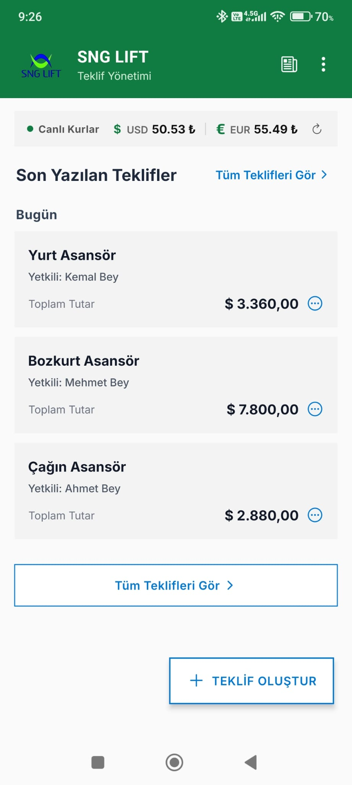
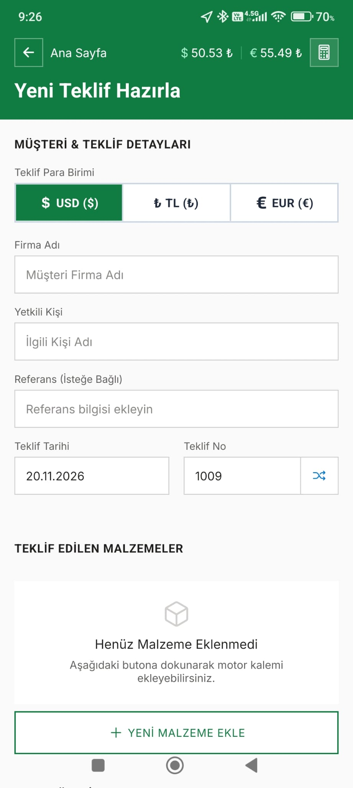
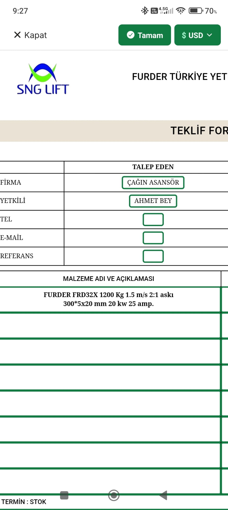

<p align="center">
  
</p>

<h1 align="center">SNG LIFT Teklif Oluşturma Uygulaması</h1>

SNG LIFT Teklif Oluşturma Uygulaması; asansör, makine ve endüstriyel taahhüt sektöründe faaliyet gösteren saha satış ekipleri, mühendisler ve yöneticiler için geliştirilmiş kurumsal bir mobil teklif, maliyet analizi ve dokümantasyon platformudur.

Geleneksel satış süreçlerinde kullanılan karmaşık, masaüstüne bağımlı ve hata yapmaya açık Excel şablonlarını modern bir mobil mimariye taşıyan bu uygulama; teklif hazırlama süresini dakikalara indirmekte, anlık döviz çevrimleri ve kâr-maliyet simülasyonları ile satış ekiplerine tam finansal kontrol sağlamaktadır.

---

## Projenin Amacı ve Çözülen Problem

Endüstriyel satış operasyonlarında ürün konfigürasyonları çok sayıda teknik değişkene (motor tipi, taşıma kapasitesi, hız, askı tipi, KDV oranları, döviz cinsi ve vade şartları) bağlıdır. Sahada manuel yapılan teklif çalışmalarında karşılaşılan başlıca problemler şunlardır:

* Masaüstü Excel yazılımlarına olan fiziksel bağımlılık ve mobilde formül bozulmaları.
* TCMB ve serbest piyasa döviz kurlarındaki dalgalanmaların teklif tutarlarına anında yansıtılamaması.
* Müşteriye sunulan belgelerde kurumsal tasarım standardının korunamaması ve dosya boyutlarının yüksekliği.
* Geçmiş tekliflerin dağınık dosyalarda tutulması nedeniyle geriye dönük arama, kopyalama ve revizyon süreçlerinin aksaması.

Bu uygulama, tüm bu iş akışını tek bir yerel mobil uygulamada toplayarak uçtan uca dijitalleştirilmiş, hatasız ve kurumsal kimliğe tam uyumlu bir operasyonel zemin sunar.

---

## Uygulama İçi Ekran Görüntüleri

### Ana Kontrol Paneli ve Canlı Kurlar
Saha satış temsilcisinin anlık döviz kurlarını takip ettiği, son hazırlanan teklif özetlerine ulaştığı ve hızlı teklif oluşturma sürecini başlattığı ana operasyon ekranı.

<p align="center">
  
</p>

### Modül ve Fonksiyon Ekranları

<p align="center">
  <span style="display: inline-block; margin: 12px; text-align: center;">
    <b>Yeni Teklif Hazırlama ve Form Yönetimi</b><br /><br />
    
  </span>
  <span style="display: inline-block; margin: 12px; text-align: center;">
    <b>Kurumsal Teklif ve PDF Önizleme Modalı</b><br /><br />
    
  </span>
</p>

<p align="center">
  <span style="display: inline-block; margin: 12px; text-align: center;">
    <b>Satış İstatistikleri ve Ciro Analiz Paneli</b><br /><br />
    
  </span>
  <span style="display: inline-block; margin: 12px; text-align: center;">
    <b>Canlı Finans ve Ekonomi Bülteni</b><br /><br />
    
  </span>
</p>

* **Yeni Teklif Hazırlama:** Müşteri unvanı, yetkili kişi, referans, çoklu para birimi (USD, TL, EUR) ve sıralı teklif numarası yönetimi.
* **Kurumsal PDF Önizleme:** Şirket logolu resmi teklif şablonunun kayıt ve paylaşım öncesi canlı önizleme modalı.
* **Satış İstatistikleri:** Dönemsel teklif adedi, onaylanan ciro toplamları ve müşteri bazlı satış analitiği paneli.
* **Ekonomi Bülteni:** Canlı döviz kurları ve güncel piyasa haberlerinin doğrudan takip edildiği finans bülteni.

---

## Modüler Mimari ve Ekran Detayları

### 1. Karşılama ve Tanıtım
Uygulama ilk kez çalıştırıldığında kullanıcıyı karşılayan, yerel durum kontrolüyle ilk kurulum adımlarını yöneten ve kurumsal kimlik arayüzüyle açılışı gerçekleştiren karşılama modülüdür.

### 2. Ana Kontrol Paneli
Kullanıcının tek dokunuşla yeni teklif oluşturabildiği, son hazırlanan tekliflerin özet kartlarını inceleyebildiği, anlık döviz kurlarını takip edebildiği ve uygulama modülleri arasında hızlı geçiş yapabildiği merkezi operasyon paneli.

### 3. Teklif Oluşturma ve Düzenleme Motoru
Teklif oluşturma sürecinin ana omurgasıdır.
* Dinamik Form Yönetimi: Müşteri unvanı, yetkili kişi, iletişim bilgileri, teslimat süresi ve ödeme koşullarının eksiksiz girişi.
* Sıralı Otomatik Teklif Numaralandırma: Yerel depolama üzerinden geçmiş teklifler taranarak teklif numaralarının ardışık olarak otomatik artırılması.
* Çoklu Para Birimi: USD, EUR ve TRY para birimleri arasında anlık geçiş ve kur katsayılarıyla toplam maliyet güncellemesi.
* Canlı Düzenleme ve Önizleme: Teklifin son halini kaydetmeden önce doğrudan arayüz üzerinde interaktif olarak görüntüleme ve alan bazlı son dakika revizyonları yapabilme.

### 4. Motor ve Malzeme Hesaplayıcı Modülü
Asansör motorları ve yardımcı teknik ekipmanlar için özel olarak kurgulanmış parametrik maliyet motorudur.
* Model bazlı katalog seçimi (FRD serisi motorlar ve teknik varyantlar).
* Liste fiyatı, bayi iskontosu, kâr marjı ve ilave maliyet kalemlerinin girilmesiyle satır bazlı net tutar hesaplama.
* Hesaplanan verilerin ana teklif tablosuna tek tıkla yeni malzeme kalemi olarak aktarılması.

### 5. Kurumsal PDF Üretim ve Paylaşım Altyapısı
* Özel kurumsal teklif şablonunu doğrudan cihaz üzerinde vektörel PDF belgesine dönüştürür.
* Teklif belgesinde şirket logosu, müşteri ve satıcı detayları, kurumsal malzeme tablosu, dip toplamlar, banka hesap ve IBAN bilgileri ile resmi imza/onay alanları eksiksiz yer alır.
* Üretilen PDF belgesi herhangi bir harici sunucuya ihtiyaç duymadan WhatsApp, E-posta veya cihazın yerel dosya yöneticisiyle anında paylaşılabilir.

### 6. Teklif Arşivi ve Durum Takibi
* Geçmişte oluşturulan tüm tekliflerin listelendiği, müşteri adı veya teklif numarasına göre anlık arama yapılabilen arşiv ekranı.
* Teklif durumlarının (Beklemede, Onaylandı, Revize Edildi) renk kodlu etiket sistemiyle izlenmesi.
* Var olan bir teklifi şablon olarak kullanarak tek tıkla kopyalama ve yeni bir teklife dönüştürme yeteneği.

### 7. Canlı Döviz ve Piyasa Servisi
* Küresel finans uç noktaları üzerinden USD/TRY ve EUR/TRY kurlarını canlı olarak çeker.
* Sayfa açılışlarında bekleme yaşanmaması adına yerel hafıza üzerinde önbellekleme stratejisi uygular; ağdan yeni veri geldiğinde arayüzü sessizce günceller.
* Zaman aşımı ve olası bağlantı kopmalarına karşı varsayılan kur değerleriyle kesintisiz çalışma garantisi sunar.

### 8. Ekonomi Haberleri ve Sektörel Bülten
* Türkiye ve dünya ekonomisine dair finansal haber akışlarını doğrudan haber kaynaklarından çeken ve ayrıştıran modül.
* Metin temizleme, görsel bağlantılarını ayrıştırma, zaman hesaplama ve haber detaylarını okuma modu.

### 9. İstatistik ve Satış Analitiği
* Yerel teklif veritabanı üzerinden toplam teklif adedi, onaylanan teklif hacmi, para birimlerine göre toplam ciro dağılımı ve başarı oranı metriklerini anlık hesaplayan analitik ekranı.

### 10. Kurumsal Yapılandırma ve Sistem Ayarları
* Satıcı firma adı, sabit telefon, GSM, e-posta, ticari unvan ve farklı bankalara ait TL/USD IBAN bilgilerinin dinamik olarak tanımlandığı yönetim paneli.

---

## Güvenlik ve Veri İzolasyonu

Kurumsal projelerde karşılaşılan finansal ve kişisel verilerin (şirket unvanı, banka IBAN bilgileri, telefon numaraları) açık kaynak depolara sızmasını önlemek adına katmanlı bir yapılandırma mimarisi uygulanmıştır:
* Gerçek banka ve şirket verileri versiyon kontrol sistemi (.gitignore) kapsamındaki yerel dosyalarda tutulur.
* Depo üzerinde sadece örnek bir şablon yapılandırması (companyConfig.example.js) yer alır.
* Dinamik yapılandırma köprüsü, yerel özel dosya mevcut olduğunda gerçek verileri devreye alır; dosyanın bulunmadığı ortamlarda ise genel şablon değerleriyle güvenle çalışmayı sürdürür.

---

## Kullanılan Teknolojiler

* **Çekirdek:** React Native 0.76+, Expo SDK 54
* **Navigasyon:** @react-navigation/native, @react-navigation/native-stack
* **Animasyon Motoru:** react-native-reanimated
* **Belge Üretimi ve Dosya Sistemi:** expo-print, expo-sharing, expo-file-system
* **Yerel Durum ve Veri Kalıcılığı:** @react-native-async-storage/async-storage
* **Görsel ve Vektörel İkonlar:** @expo/vector-icons, expo-image-picker
* **Ağ ve Veri Çözümleme:** Fetch API, AbortController, Native XML/RSS Parser

---

## Kurulum ve Çalıştırma Kılavuzu

### Gereksinimler
* Node.js (v18 veya üzeri önerilir)
* npm veya yarn paket yöneticisi
* Android Studio (Android Emulator için) veya fiziksel bir test cihazı

### Adım Adım Kurulum

1. Depoyu yerel makinenize klonlayın:
```bash
git clone https://github.com/kullanici-adi/sng-lift-teklif.git
cd sng-lift-teklif
```

2. Proje bağımlılıklarını yükleyin:
```bash
npm install
```

3. Yapılandırma dosyasını hazırlayın:
`src/config/companyConfig.example.js` dosyasını referans alarak `src/config/companyConfig.js` dosyasını oluşturun ve kendi şirket/banka bilgilerinizi tanımlayın:
```bash
cp src/config/companyConfig.example.js src/config/companyConfig.js
```

4. Geliştirme sunucusunu başlatın:
```bash
npx expo start
```

5. Uygulamayı test edin:
* Fiziksel Android cihazınızda test etmek için terminalde görüntülenen QR kodu Expo Go uygulaması ile tarayın.
* Android Emulator üzerinde başlatmak için terminal açıkken klavyeden `a` tuşuna basın.
