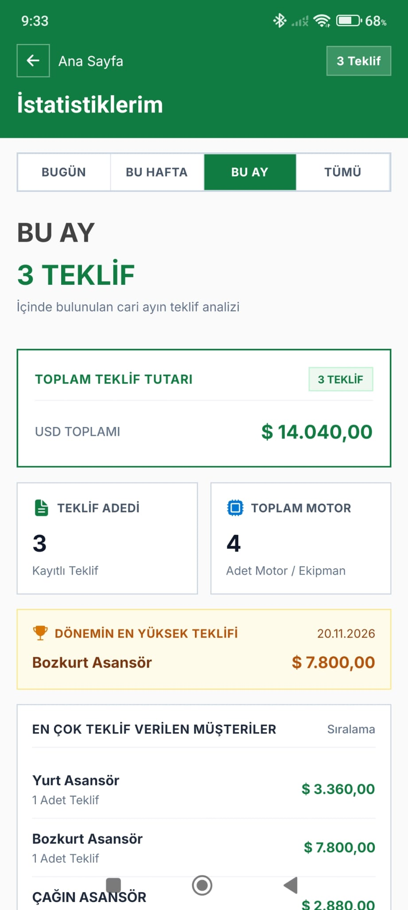

<p align="center">
  
</p>

<h1 align="center">SNG LIFT Teklif Oluşturma Uygulaması</h1>

SNG LIFT Teklif Oluşturma Uygulaması; asansör, makine ve endüstriyel taahhüt sektöründe faaliyet gösteren saha satış ekipleri, mühendisler ve yöneticiler için geliştirilmiş kurumsal bir mobil teklif, maliyet analizi ve dokümantasyon platformudur.

Geleneksel satış süreçlerinde kullanılan karmaşık, masaüstüne bağımlı ve hata yapmaya açık Excel şablonlarını modern bir mobil mimariye taşıyan bu uygulama; teklif hazırlama süresini dakikalara indirmekte, anlık döviz çevrimleri ve kâr-maliyet simülasyonları ile satış ekiplerine tam finansal kontrol sağlamaktadır.

---

## Projenin Amacı ve Çözülen Problem

Endüstriyel satış operasyonlarında ürün konfigürasyonları çok sayıda teknik değişkene (motor tipi, taşıma kapasitesi, hız, askı tipi, KDV oranları, döviz cinsi ve vade şartları) bağlıdır. Sahada manuel yapılan teklif çalışmalarında karşılaşılan başlıca problemler şunlardır:

* Masaüstü Excel yazılımlarına olan fiziksel bağımlılık ve mobilde formül bozulmaları.
* TCMB ve serbest piyasa döviz kurlarındaki dalgalanmaların teklif tutarlarına anında yansıtılamaması.
* Müşteriye sunulan belgelerde kurumsal tasarım standardının korunamaması ve dosya boyutlarının yüksekliği.
* Geçmiş tekliflerin dağınık dosyalarda tutulması nedeniyle geriye dönük arama, kopyalama ve revizyon süreçlerinin aksaması.

Bu uygulama, tüm bu iş akışını tek bir yerel mobil uygulamada toplayarak uçtan uca dijitalleştirilmiş, hatasız ve kurumsal kimliğe tam uyumlu bir operasyonel zemin sunar.

---

## Uygulama İçi Ekran Görüntüleri

### 1. Ana Kontrol Paneli ve Canlı Kurlar
Saha satış temsilcisinin güncel döviz kurlarını anlık takip ettiği, son hazırlanan teklif özetlerine ulaştığı ve hızlı teklif oluşturma sürecini başlattığı ana operasyon ekranı.

<p align="center">
  
</p>

---

### 2. Yeni Teklif Hazırlama ve Form Yönetimi
Müşteri firma unvanı, yetkili kişi, referans, teklif tarihi ve sıralı teklif numarasının yönetildiği; para birimi (USD, TL, EUR) seçimi ile dinamik malzeme kalemlerinin eklendiği teklif oluşturma arayüzü.

<p align="center">
  
</p>

---

### 3. Kurumsal Teklif ve Vektörel PDF Önizleme Modalı
Oluşturulan teklifin kaydedilmeden veya müşteriye iletilmeden önce resmi kurumsal şablonda, şirket logosu ve teknik parametreleriyle birlikte canlı olarak kontrol edildiği interaktif önizleme ekranı.

<p align="center">
  
</p>

---

### 4. Satış İstatistikleri ve Ciro Analiz Paneli
Bugün, bu hafta, bu ay ve tüm zamanlar bazında toplam teklif hacmi, onaylanan teklif tutarları, motor/ekipman adetleri ve en çok teklif verilen kurumsal müşterilerin anlık analiz edildiği raporlama paneli.

<p align="center">
  
</p>

---

### 5. Canlı Finans ve Ekonomi Bülteni
Satış ekiplerinin küresel ve yerel piyasa dinamiklerini, döviz hareketlerini ve sektörel haber akışlarını doğrudan uygulama içinden takip etmesini sağlayan entegre ekonomi bülteni.

<p align="center">
  
</p>

---

## Modüler Mimari ve Ekran Detayları

### 1. Karşılama ve Onboarding (WelcomeScreen)
Uygulama ilk kez çalıştırıldığında kullanıcıyı karşılayan, asenkron yerel durum kontrolüyle ilk kurulum adımlarını yöneten ve kurumsal kimlik animasyonlarıyla açılışı gerçekleştiren karşılama modülüdür.

### 2. Ana Kontrol Paneli (HomeScreen)
Kullanıcının tek dokunuşla yeni teklif oluşturabildiği, son hazırlanan tekliflerin özet kartlarını inceleyebildiği, anlık döviz kurlarını takip edebildiği ve uygulama modülleri arasında hızlı geçiş yapabildiği merkezi operasyon paneli.

### 3. Teklif Oluşturma ve Düzenleme Motoru (CreateProposalScreen)
Teklif oluşturma sürecinin ana omurgasıdır.
* Dinamik Form Yönetimi: Müşteri unvanı, yetkili kişi, iletişim bilgileri, teslimat süresi ve ödeme koşullarının validasyonlu girişi.
* Sıralı Otomatik Teklif Numaralandırma: Yerel depolama üzerinden geçmiş teklifler taranarak teklif numaralarının ardışık olarak otomatik artırılması.
* Çoklu Para Birimi: USD, EUR ve TRY para birimleri arasında anlık geçiş ve kur çarpanlarıyla toplam maliyet güncellemesi.
* Canlı Düzenleme ve Önizleme: Teklifin son halini kaydetmeden önce doğrudan WebView üzerinde interaktif olarak görüntüleme ve alan bazlı son dakika revizyonları yapabilme.

### 4. Motor ve Malzeme Hesaplayıcı Modalı (ProposalCalculatorModal)
Asansör motorları ve yardımcı teknik ekipmanlar için özel olarak kurgulanmış parametrik maliyet motorudur.
* Model bazlı katalog seçimi (FRD serisi motorlar ve teknik varyantlar).
* Liste fiyatı, bayi iskontosu, kâr marjı ve ilave maliyet kalemlerinin girilmesiyle satır bazlı net tutar hesaplama.
* Hesaplanan verilerin ana teklif tablosuna tek tıkla yeni malzeme kalemi olarak aktarılması.

### 5. Kurumsal PDF Üretim ve Paylaşım Hattı (pdfGenerator & Expo Print)
* Cihaz donanımını doğrudan kullanarak HTML5, CSS tabanlı özel bir kurumsal teklif şablonunu vektörel PDF belgesine dönüştürür.
* Teklif belgesinde şirket logosu, müşteri ve satıcı detayları, en az 8 satırlık kurumsal malzeme tablosu, dip toplamlar, banka hesap ve IBAN bilgileri ile resmi imza/onay kutucukları eksiksiz yer alır.
* Üretilen PDF belgesi Expo Sharing ve FileSystem köprüsü sayesinde herhangi bir sunucu bağımlılığı olmaksızın WhatsApp, E-posta veya cihazın yerel dosya yöneticisiyle anında paylaşılabilir.

### 6. Teklif Arşivi ve Durum Takibi (AllProposalsScreen)
* Geçmişte oluşturulan tüm tekliflerin listelendiği, müşteri adı veya teklif numarasına göre anlık arama yapılabilen arşiv ekranı.
* Teklif durumlarının (Beklemede, Onaylandı, Revize Edildi) renk kodlu badge sistemiyle izlenmesi.
* Var olan bir teklifi şablon olarak kullanarak tek tıkla kopyalama ve yeni bir teklife dönüştürme yeteneği.

### 7. Canlı Döviz ve Piyasa Servisi (currencyService)
* Küresel finans API uç noktaları üzerinden USD/TRY ve EUR/TRY kurlarını canlı olarak çeker.
* Sayfa açılışlarında kullanıcıyı bekletmemek adına AsyncStorage üzerinde önbellekleme (cache-first) stratejisi uygular; ağdan yeni veri geldiğinde arayüzü sessizce günceller.
* Zaman aşımı (AbortController) ve bağlantı kopmalarına karşı varsayılan kur değerleriyle kesintisiz çalışma garantisi sunar.

### 8. Ekonomi Haberleri ve Sektörel Bülten (EconomyNewsScreen & newsService)
* Türkiye ve dünya ekonomisine dair finansal haber akışlarını doğrudan RSS kaynaklarından çeken ve ayrıştıran modül.
* HTML entity temizleme, görsel URL ayrıştırma, bağıl zaman hesaplama ("3 saat önce") ve haber detaylarını okuma modu.

### 9. İstatistik ve Satış Analitiği (StatisticsScreen)
* Yerel teklif veritabanı üzerinden toplam teklif adedi, onaylanan teklif hacmi, para birimlerine göre toplam ciro dağılımı ve başarı oranı metriklerini anlık hesaplayan analitik ekranı.

### 10. Kurumsal Yapılandırma ve Sistem Ayarları (SettingsScreen)
* Satıcı firma adı, sabit telefon, GSM, e-posta, ticari unvan ve farklı bankalara ait TL/USD IBAN bilgilerinin dinamik olarak tanımlandığı yönetim paneli.

---

## Teknik Yaklaşımlar ve Mühendislik Prensipleri

### 60 FPS GPU Hızlandırmalı Animasyonlar
Kullanıcı arayüzünde React Native Reanimated kütüphanesi aktif olarak kullanılmıştır. Dinamik header küçülmeleri, başlık geçişleri ve liste yüklemeleri JavaScript iş parçacığını (thread) bloklamadan, doğrudan GPU seviyesinde transform ve opacity interpolasyonları ile çalıştırılır.

### Çevrimdışı Öncelikli Mimari (Offline-First)
Saha personelinin şantiye veya fabrika gibi internet erişiminin kısıtlı olduğu ortamlarda çalışabilmesi hedeflenmiştir. Uygulama; teklif oluşturma, PDF üretme, arşivleme ve geçmiş kayıtlara erişim fonksiyonlarını hiçbir harici sunucuya veya internet bağlantısına ihtiyaç duymadan tamamen yerel depolama (AsyncStorage) üzerinde çalıştırabilir.

### Güvenlik ve Hassas Veri İzolasyonu
Kurumsal projelerde karşılaşılan en büyük risklerden biri olan finansal verilerin (şirket IBAN'ları, özel iletişim numaraları) kaynak koda gömülü kalması ve açık depolara sızması problemi katmanlı bir yapılandırma mimarisiyle çözülmüştür:
* Gerçek banka ve şirket verileri versiyon kontrol sistemi (.gitignore) kapsamındaki yerel dosyalarda saklanır.
* Proje içinde genel bir şablon yapılandırması (companyConfig.example.js) yer alır.
* Dinamik yükleyici köprü (config/index.js), yerel özel dosya mevcutsa onu devreye alır, bulunmadığı durumlarda ise hataya düşmeden genel şablon değerleriyle çalışmayı sürdürür.

---

## Kullanılan Teknolojiler

* **Çekirdek:** React Native 0.76+, Expo SDK 54
* **Navigasyon:** @react-navigation/native, @react-navigation/native-stack
* **Animasyon Motoru:** react-native-reanimated
* **Belge Üretimi ve Dosya Sistemi:** expo-print, expo-sharing, expo-file-system
* **Yerel Durum ve Veri Kalıcılığı:** @react-native-async-storage/async-storage
* **Görsel ve Vektörel İkonlar:** @expo/vector-icons, expo-image-picker
* **Ağ ve Veri Çözümleme:** Fetch API, AbortController, Native XML/RSS Parser

---

## Kurulum ve Çalıştırma Kılavuzu

### Gereksinimler
* Node.js (v18 veya üzeri önerilir)
* npm veya yarn paket yöneticisi
* Android Studio (Android Emulator için) veya fiziksel bir test cihazı

### Adım Adım Kurulum

1. Depoyu yerel makinenize klonlayın:
```bash
git clone https://github.com/kullanici-adi/sng-lift-teklif.git
cd sng-lift-teklif
```

2. Proje bağımlılıklarını yükleyin:
```bash
npm install
```

3. Yapılandırma dosyasını hazırlayın:
`src/config/companyConfig.example.js` dosyasını referans alarak `src/config/companyConfig.js` dosyasını oluşturun ve kendi şirket/banka bilgilerinizi tanımlayın:
```bash
cp src/config/companyConfig.example.js src/config/companyConfig.js
```

4. Geliştirme sunucusunu başlatın:
```bash
npx expo start
```

5. Uygulamayı test edin:
* Fiziksel Android cihazınızda test etmek için terminalde görüntülenen QR kodu Expo Go uygulaması ile tarayın.
* Android Emulator üzerinde başlatmak için terminal açıkken klavyeden `a` tuşuna basın.
